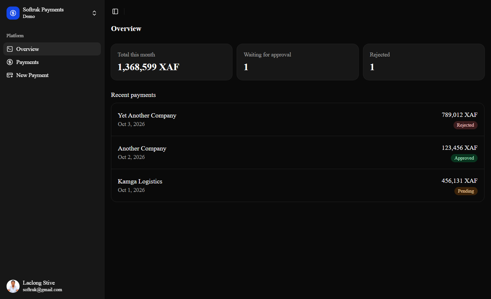

 
# Payment Dashboard

A responsive dashboard for tracking and creating payments, built with Next.js and TypeScript. Currently runs on a mock API; a Django REST Framework backend is planned.

**Live demo:**  



## Features

- Overview with totals and recent payments
- Payments list with loading, error (with retry) and empty states
- Payment detail page with a status timeline and rejection reason
- Create payment form with validation and accessible error messages
- Responsive layout: sidebar on desktop, collapsible on mobile
- Dark theme

## Tech stack

- Next.js 16 (App Router) and React
- TypeScript
- Tailwind CSS and shadcn/ui
- TanStack Query for data fetching and mutations

## Getting started

Requires Node.js 20.9 or newer.

```bash
git clone <your-repo-url>
cd payment_dashboard
npm install
npm run dev
```

Open http://localhost:3000 (redirects to `/dashboard`).

Other scripts: `npm run lint`, `npm run build`.

## Project structure

```
app/dashboard/        routes: overview, payments list, detail, new
components/payments/  payment list, row, form, detail, timeline, status badge
components/layout/    dashboard shell (sidebar + header)
hooks/use-payments.ts React Query hooks
lib/api.ts            mock API layer (swapped for the real backend later)
types/payment.ts      shared types
```

## Design decisions

- **Mock API behind one file.** All data access goes through `lib/api.ts`, so connecting the real backend only changes that file.
- **State handled explicitly.** Every data view has loading, error and empty states.
- **Dashboard routes grouped under `/dashboard`** to make adding authentication straightforward later.

## Roadmap

- [ ] Django REST Framework backend
- [ ] Authentication and protected routes
- [ ] Edit and delete payments
- [ ] Filters and search on the payments list

